<p align="center">
  
</p>

# Homebrew Update Assistant

[](LICENSE)


A scheduled Bash script that keeps Homebrew updated, backed up, health-checked and scanned for vulnerabilities, with a native macOS app on top for viewing results and acting on them.

## What it does

- **Unattended updates.** A LaunchAgent runs the script daily at 3 AM: `brew update`, upgrade outdated formulae and casks (respecting pins and exclusions), then `brew cleanup`.
- **Safety net.** Before every run it takes a Brewfile backup. Runs never overlap, network calls retry with backoff, and each step has its own exit code.
- **Health and security reports.** Every run saves a `brew doctor` report, a [Grype](https://github.com/anchore/grype) vulnerability scan of the Cellar, a `brew vulns` (OSV.dev) scan of installed formulae, and a list of deprecated or disabled packages.
- **Machine-readable results.** Each run writes a `*.summary.json` and sends a macOS notification that links back to the run.
- **Menu bar and window app.** The app shows runs, installed packages, Security and Doctor findings, and backups. From it you can update, dry run, upgrade, pin, exclude, uninstall, restore and edit the schedule.

## Contents

- [Screenshots](#screenshots)
- [Architecture](#architecture)
- [Tech stack and dependencies](#tech-stack-and-dependencies)
- [Install](#install)
- [The update script](#the-update-script)
- [Security scanning](#security-scanning)
- [Notifications](#notifications)
- [The Brew Updates app](#the-brew-updates-app)
- [Data model: files on disk](#data-model-files-on-disk)
- [Configuration](#configuration)
- [Project structure](#project-structure)
- [Development](#development)
- [Deployment](#deployment)
- [Sharing with others](#sharing-with-others)
- [Troubleshooting](#troubleshooting)
- [Known constraints](#known-constraints)
- [Roadmap](#roadmap)

## Screenshots

A quick tour of the app (the GIF cycles through every screen). Click any thumbnail below for the full-size screenshot.

<p align="center">
  <a href="docs/images/app-tour.gif">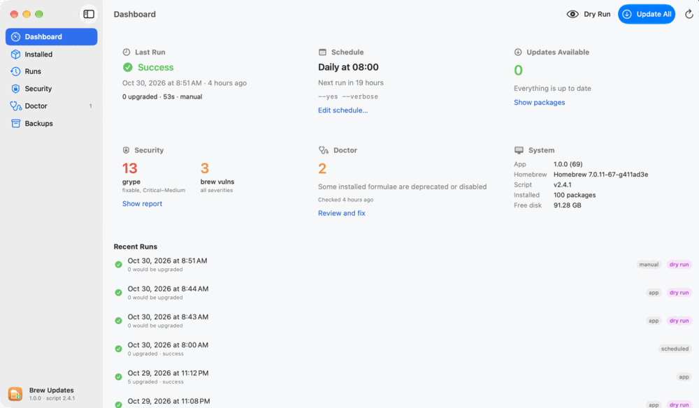</a>
</p>

<table>
  <tr>
    <td align="center"><a href="docs/images/screenshots/dashboard.png">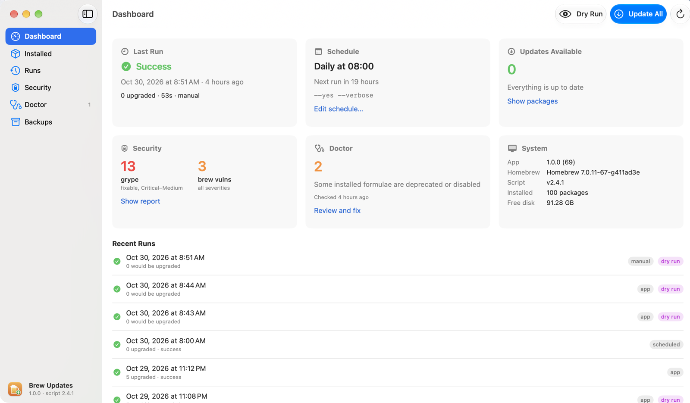</a><br/><sub><b>Dashboard</b></sub></td>
    <td align="center"><a href="docs/images/screenshots/installed.png">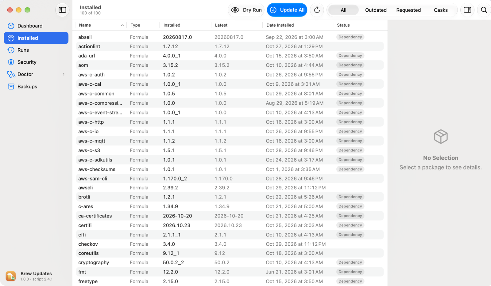</a><br/><sub><b>Installed</b></sub></td>
    <td align="center"><a href="docs/images/screenshots/runs.png">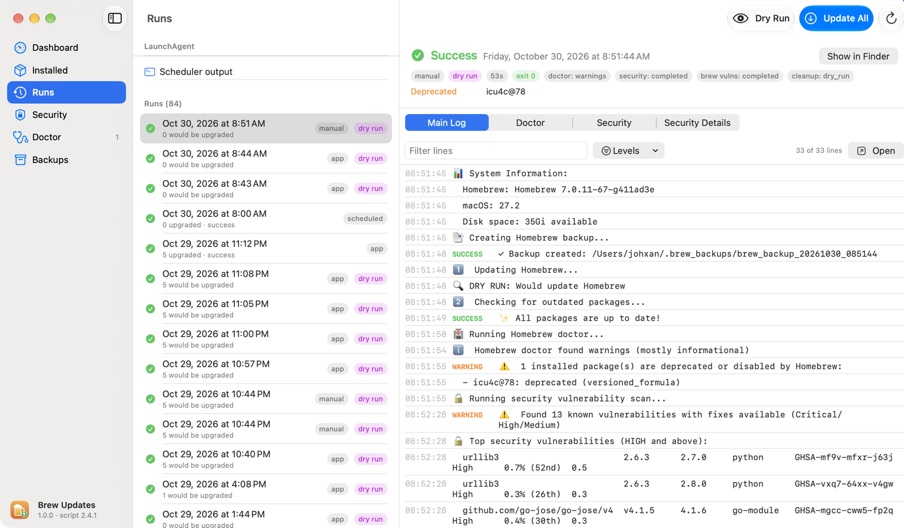</a><br/><sub><b>Runs</b></sub></td>
  </tr>
  <tr>
    <td align="center"><a href="docs/images/screenshots/security.png">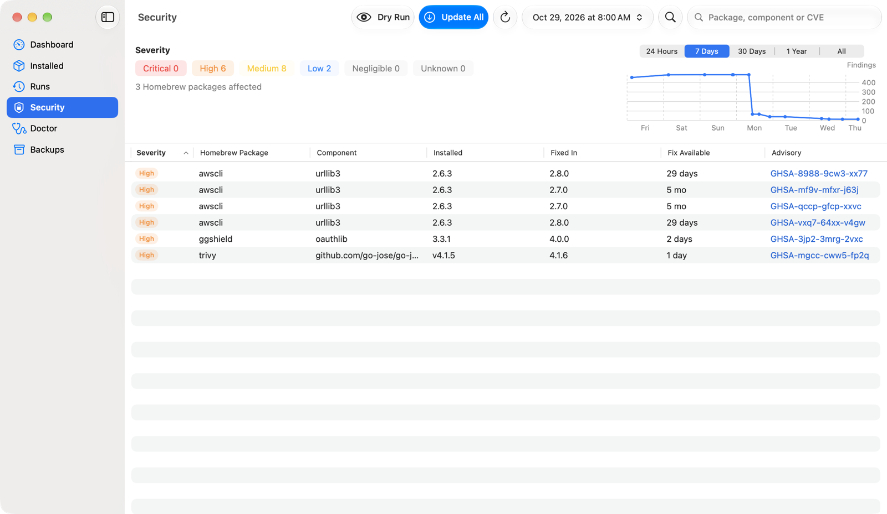</a><br/><sub><b>Security</b></sub></td>
    <td align="center"><a href="docs/images/screenshots/doctor.png">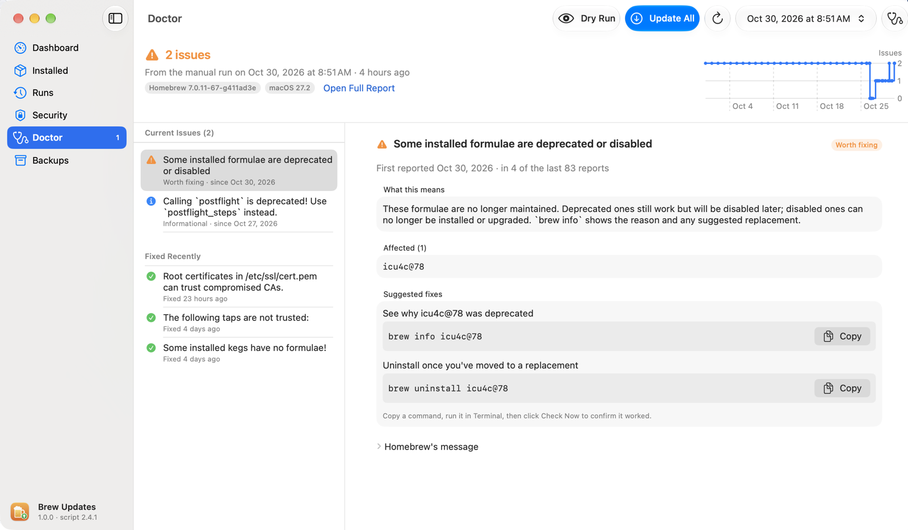</a><br/><sub><b>Doctor</b></sub></td>
    <td align="center"><a href="docs/images/screenshots/backups.png">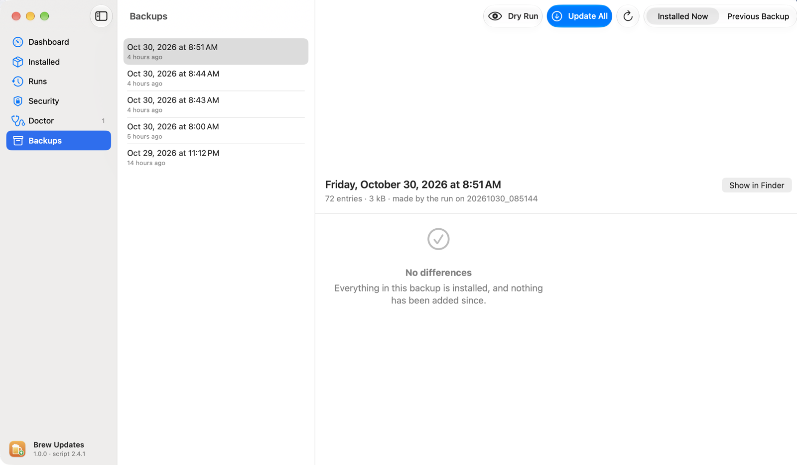</a><br/><sub><b>Backups</b></sub></td>
  </tr>
</table>

## Architecture

The script is the engine and the only thing that upgrades packages. The LaunchAgent and the app are its two triggers, and `~/.brew_logs` is the contract between them: the script writes run files there and the app reads them.

```mermaid
flowchart TB
    subgraph triggers["Triggers"]
        agent["LaunchAgent<br/>com.user.brew-update<br/>(daily 3 AM)"]
        user["Terminal / Finder<br/>(double-click .command)"]
        app["Brew Updates.app<br/>(menu bar + window)"]
    end

    script["~/bin/brew-updates.command<br/>update · upgrade · doctor · scan · cleanup"]

    subgraph files["Local state"]
        logs[("~/.brew_logs<br/>logs, reports, *.summary.json,<br/>run lock")]
        backups[("~/.brew_backups<br/>Brewfiles")]
        config[("~/.brew_update_config<br/>+ LaunchAgent plist")]
    end

    subgraph tools["External tools"]
        brew["Homebrew<br/>brew CLI + GitHub"]
        grype["Grype<br/>vulnerability DB"]
        notify["Notification Center<br/>terminal-notifier / osascript"]
    end

    agent --> script
    user --> script
    app -- "--yes --no-color<br/>BREW_UPDATE_TRIGGER=app" --> script
    script --> files
    script --> tools
    app -- "reads runs, edits config<br/>and schedule" --> files
    app -- "brew info / pin / uninstall<br/>(HOMEBREW_NO_AUTO_UPDATE=1)" --> brew
    notify -. "brewupdates:// links" .-> app
```

| Component | Lives in | Role |
| --- | --- | --- |
| `brew-updates.command` | source here, deployed to `~/bin/` | Does every update, upgrade, backup, doctor run and scan. Holds the run lock |
| LaunchAgent | `~/Library/LaunchAgents/com.user.brew-update.plist` | Runs the deployed script daily (`--yes --verbose`, notifications on) |
| Brew Updates app | `app/`, installed to `/Applications/Brew Updates.app` | Reads `~/.brew_logs` and runs the deployed script. Makes only direct `brew` changes the user asks for (pin, uninstall, restore) |
| `scripts/setup.sh` | repo | Deploys the script, installs or reloads the LaunchAgent, checks dependencies |
| `scripts/install-app.sh` | repo | Builds and signs the app into `/Applications` |

Each part is covered in its own section below.

## Tech stack and dependencies

| Layer | Technology |
| --- | --- |
| Script | Bash (compatible with macOS `/bin/bash` 3.2) |
| Scheduling | launchd LaunchAgent |
| Security scan | Grype + jq |
| Notifications | terminal-notifier (clickable), falling back to `osascript` |
| App | Swift 6, SwiftUI, macOS 15+, Swift Charts |
| App project | XcodeGen (`app/project.yml`) |
| Quality | ShellCheck, SwiftLint, pre-commit, ggshield, GitHub Actions |

**Runtime dependencies** (setup.sh reports which are missing):

| Dependency | Install | Required? | Without it |
| --- | --- | --- | --- |
| Homebrew | [brew.sh](https://brew.sh) | Yes | Script exits with code 4 |
| git | Xcode Command Line Tools | Yes | Pre-flight check fails |
| Grype | `brew install --cask grype` | For scans | Scan is skipped with a warning |
| jq | `brew install jq` | For detailed scan report | Only the table and JSON reports are written |
| terminal-notifier | `brew install terminal-notifier` | No | Notifications aren't clickable |
| coreutils | `brew install coreutils` | No | Commands run without `gtimeout` (no timeout) |

**Development dependencies:** Xcode, `brew install xcodegen swiftlint shellcheck ggshield`, and `pre-commit` (via pip).

## Install

```bash
git clone https://github.com/jxman/homebrew-update-assistant.git
cd homebrew-update-assistant

./scripts/setup.sh          # script → ~/bin, LaunchAgent (daily 3 AM), dirs, sample config
./scripts/install-app.sh    # optional: build the app into /Applications (+ Desktop alias)
```

`setup.sh` copies the script to `~/bin/` and creates `~/.brew_logs`, `~/.brew_backups` and a sample `~/.brew_update_config`. It installs the LaunchAgent (or keeps the existing one so a custom schedule survives), reloads it with `launchctl bootout` and `bootstrap`, checks the dependencies above and confirms the deployed checksum. See [DEPLOYMENT.md](DEPLOYMENT.md) for reinstalling, uninstalling and custom schedules.

You can also run the script straight from the repo without installing it: `./brew-updates.command --dry-run`. On macOS the `.command` extension makes it double-clickable in Finder.

## The update script

### Run pipeline

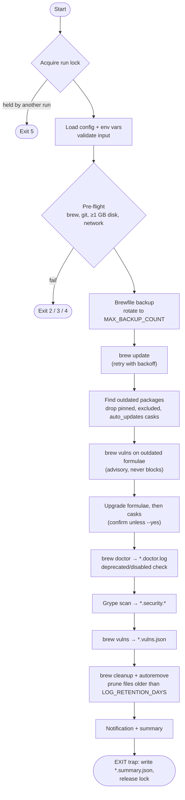

The EXIT trap also runs on errors and on Ctrl-C/SIGINT, so every run that got the lock leaves a summary (status `cancelled` if it was interrupted) and releases the lock.

### Usage

```bash
./brew-updates.command                          # interactive
./brew-updates.command --dry-run --verbose      # preview, no changes
./brew-updates.command --yes                    # unattended
./brew-updates.command --packages "node git" --yes   # upgrade only these
./brew-updates.command --skip-casks --skip-cleanup   # quick formulae-only run
```

| Option | Description |
| --- | --- |
| `-d, --dry-run` | Show what would be updated without making changes |
| `-v, --verbose` | Detailed logging |
| `-y, --yes` | Answer yes to all prompts (automation mode) |
| `-s, --skip-casks` | Formulae only |
| `-c, --skip-cleanup` | Skip `brew cleanup` |
| `--skip-security-scan` | Skip the Grype and `brew vulns` scans for this run |
| `-p, --packages LIST` | Only upgrade these packages (space- or comma-separated). Pins and exclusions still apply |
| `--no-color` | Disable colour (also honours `NO_COLOR`) |
| `--version` | Print the script version |
| `-h, --help` | Help with examples |

### Exit codes

| Code | Meaning |
| --- | --- |
| `0` | Success |
| `1` | General error, or some package upgrades failed |
| `2` | Network error |
| `3` | Insufficient disk space |
| `4` | Homebrew error (e.g. `brew update` failed after retries) |
| `5` | Another run is already in progress |

### Safety design

- **No `eval`.** Commands run as arrays, and every config value, env var and package name is checked against a regex.
- **Run lock.** `~/.brew_logs/.brew-updates.lock/` is created with an atomic `mkdir` and records the holder's PID. A stale lock is cleared automatically.
- **Retries.** Network operations use exponential backoff (`BREW_UPDATE_MAX_RETRIES`, `BREW_UPDATE_TIMEOUT`).
- **Graceful degradation.** A failed doctor run, scan or notification is logged but doesn't stop the run.
- **User privileges only.** The script never calls `sudo` itself.

## Security scanning

After the doctor check, the script runs two scanners with different blind spots:

| | Grype | `brew vulns` |
| --- | --- | --- |
| Looks at | Files in the Cellar | Each formula's source repo and version, looked up in OSV.dev |
| Finds | Dependencies bundled inside formulae (Ruby gems in `cocoapods`, Go stdlib in `terraform`, Python packages in `awscli`) | Vulnerabilities in the formula's own upstream project |
| Doesn't cover | Software without a package manifest | Casks, formulae without a supported source URL (e.g. `hashicorp/tap/terraform`) |
| Unfixed findings | Hidden (`--only-fixed`, so the count tracks what an upgrade can fix) | Shown |
| Needs | `brew install --cask grype` | A Homebrew with `brew vulns`, and `jq` (included with macOS) |

Grype runs `grype dir:$(brew --prefix)/Cellar --only-fixed`. `brew vulns --json` writes `*.vulns.json`, including which formulae it checked and skipped.

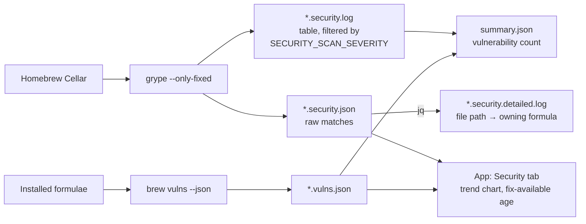

- Grype runs when `SECURITY_SCAN_ENABLED=true` (the default) and grype is installed. `brew vulns` runs when `VULNS_SCAN_ENABLED=true` (the default).
- `SECURITY_SCAN_SEVERITY` sets the lowest level shown in the console and log for both scans (`LOW`, `MEDIUM`, `HIGH`, `CRITICAL`; default `HIGH,CRITICAL`). The reports and counts keep every level.
- Vulnerabilities are reported but never block the run. Before upgrading, the outdated formulae are checked with `brew vulns` and those with known vulnerabilities in the installed version are listed. Upgrades aren't held back: a vulnerable installed version is a reason to upgrade, and the new version's status is only known once it's installed. The scan after the upgrade shows what remains.
- Deprecated and disabled formulae and casks come from `brew info --json=v2 --installed` and are listed in the run summary and on the app's Doctor screen.
- `scripts/fix-vulnerabilities.sh` upgrades the formulae that usually carry the vulnerable dependencies, updates pip/urllib3, then scans again.
- In the app, **Scan Now** runs the same Grype and `brew vulns` commands and keeps the result in memory only. The Security tab can show either scanner or both, matched by advisory ID and aliases.

The parent-package mappings, a manual Cellar search and remediation tips are in [docs/VULNERABILITY_FIX_QUICKSTART.md](docs/VULNERABILITY_FIX_QUICKSTART.md). Grype setup is in [docs/SECURITY_SETUP_SUMMARY.md](docs/SECURITY_SETUP_SUMMARY.md).

## Notifications

Notifications are sent only when `ENABLE_NOTIFICATIONS=true`. The LaunchAgent sets it; you can also set it in the config file or as an env var.

| Event | Sound |
| --- | --- |
| Run starting | Submarine |
| Updates available (with count) | Purr |
| Completed successfully | Glass |
| Everything already up to date | Blow |
| Warnings or failures | Basso |

When `terminal-notifier` is installed, clicking a notification opens the run in the app via a `brewupdates://run/{RUN_ID}` link (if `~/.brew_logs/.brew-updates-app` points at an installed app) or opens the log folder otherwise. Without terminal-notifier, the script falls back to non-clickable `osascript` notifications.

## The Brew Updates app

A native SwiftUI app in [`app/`](app/) with a menu bar extra and a main window. It never upgrades packages itself. **Update All**, **Dry Run** and **Upgrade Selected** all launch the deployed script, so every run from the app gets the same backup, lock, logs and summary as a scheduled run.

| Screen | What it shows / does |
| --- | --- |
| Dashboard | Last run, outdated count, system and app version, open doctor issues |
| Installed | Formulae and casks with dependencies. Pin/unpin, exclude, upgrade selected, uninstall (dependency-aware). Cask apps found on disk; `auto_updates` casks show the app's own version |
| Runs | Every run's summary and log, plus live output with Stop for runs started in the app |
| Security | Latest scan findings, a trend chart with a date range, fix-available age, Scan Now |
| Doctor | Each `brew doctor` warning explained with copyable fixes, history across runs, Check Now, plus the app's own checks (missing cask apps, unreadable casks) |
| Backups | Compare a Brewfile backup with what's installed or with the previous backup; restore missing taps, formulae and casks |
| Settings (⌘,) | Schedule on/off, time and days, run flags (rewrites the plist, then reloads). Every `~/.brew_update_config` setting |
| Menu bar / Dock | Warning icon after a failed run; Dock badge with the update count |
| Run menu | Dry Run (⇧⌘U), Update All… (⌘U) and Stop (⌘.), also on the toolbar as separate Dry Run and Update All buttons |
| Help | A separate Help window explaining each screen |

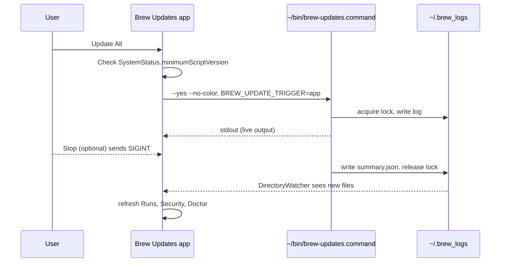

**Rules the app follows:**

- It calls only the **deployed** `~/bin/brew-updates.command` and reads run data only from `*.summary.json` ([schema](docs/run-summary-schema.md)).
- Every `brew` call sets `HOMEBREW_NO_AUTO_UPDATE=1` and uses the LaunchAgent's PATH (`BrewService.searchPath`).
- Restores and uninstalls take the script's run lock. Password prompts use the bundled askpass dialog for `sudo -A`.
- Schedule changes back up the plist and reload it, but never while a run holds the lock.

Code layout (`Models/` → `Services/` → `AppModel` → `Views/`), the Xcode workflow and a SwiftUI walkthrough are in [app/GUIDE.md](app/GUIDE.md).

## Data model: files on disk

Each run is identified by `RUN_ID = YYYYMMDD_HHMMSS`.

| Path | Written by | Contents |
| --- | --- | --- |
| `~/.brew_logs/brew_update_{RUN_ID}.log` | script | Main run log |
| `….upgrades.log` | script | Per-package upgrade output |
| `….doctor.log` | script | `brew doctor` report |
| `….security.log` / `.security.json` / `.security.detailed.log` | script | Grype table, raw JSON, file-path report |
| `….vulns.json` | script | `brew vulns --json` report |
| `….summary.json` | script (EXIT trap) | Run result for the app: [schema v1](docs/run-summary-schema.md) |
| `~/.brew_logs/.brew-updates.lock/` | script, app | Run lock (PID inside) |
| `~/.brew_logs/.brew-updates-app` | app | Path to the installed app, for notification links |
| `~/.brew_logs/launchagent.log`, `launchagent_error.log` | launchd | LaunchAgent stdout/stderr |
| `~/.brew_backups/brew_backup_{RUN_ID}` | script | Brewfile (`brew bundle dump`) |
| `~/.brew_update_config` | user, app | Settings (below) |
| `~/Library/LaunchAgents/com.user.brew-update.plist` | setup.sh, app | Schedule. The app keeps a `.app-backup` |

Per-run files older than `LOG_RETENTION_DAYS` are deleted at the end of each run, and only the newest `MAX_BACKUP_COUNT` backups are kept.

## Configuration

`~/.brew_update_config` uses `KEY=value` lines. Values can be quoted and can end with a `# comment` (after a space). A full sample is in [examples/brew_update_config.example](examples/brew_update_config.example).

| Key | Default | Meaning |
| --- | --- | --- |
| `MAX_BACKUP_COUNT` | `5` | Brewfile backups to keep |
| `LOG_RETENTION_DAYS` | `30` | Delete per-run files older than this |
| `SKIP_CASKS_BY_DEFAULT` | `false` | Act as if `--skip-casks` was passed |
| `CLEANUP_BY_DEFAULT` | `true` | `false` acts as if `--skip-cleanup` was passed |
| `ENABLE_NOTIFICATIONS` | `false` | macOS notifications (the LaunchAgent sets `true`) |
| `SECURITY_SCAN_ENABLED` | `true` | Run the Grype scan |
| `SECURITY_SCAN_SEVERITY` | `HIGH,CRITICAL` | Lowest level shown in the console and log, for both scans |
| `VULNS_SCAN_ENABLED` | `true` | Run the `brew vulns` scan |
| `EXCLUDED_FORMULAE` | empty | Space-separated exact names never upgraded |
| `EXCLUDED_CASKS` | empty | Same, for casks |

Exclusions match exact names (`node` doesn't exclude `node@20`), and pinned formulae are never upgraded either. If any name in an exclusion list fails validation, the whole list is ignored. `AUTO_UPGRADE`, `LOG_LEVEL` and `BACKUP_RETENTION_DAYS` are retired and ignored.

| Environment variable | Default | Meaning |
| --- | --- | --- |
| `BREW_UPDATE_TIMEOUT` | `300` | Per-command timeout (seconds) |
| `BREW_UPDATE_MAX_RETRIES` | `3` | Retry attempts for network operations |
| `BREW_UPDATE_TRIGGER` | `scheduled` (LaunchAgent) / `manual` | `trigger` label in the summary, e.g. `app` |
| `ENABLE_NOTIFICATIONS` | `false` | Same as the config key |
| `NO_COLOR` | unset | Disable colour |

## Project structure

```text
.
├── brew-updates.command        # The update script (~1,700 lines)
├── scripts/
│   ├── setup.sh                # Deploy script to ~/bin, install/reload LaunchAgent (--reset-launchagent, --uninstall)
│   ├── uninstall.sh            # Remove script + LaunchAgent; --logs/--backups/--config/--all, --dry-run
│   ├── install-app.sh          # Build + sign the app into /Applications (--package → dist/ zip)
│   └── fix-vulnerabilities.sh  # Upgrade formulae that carry vulnerable dependencies, rescan
├── app/
│   ├── project.yml             # XcodeGen source of truth (BrewUpdates.xcodeproj is generated, gitignored)
│   ├── BrewUpdates/            # Models/ → Services/ → AppModel → Views/, Resources/brew-askpass.sh
│   ├── BrewUpdatesTests/       # Swift Testing, unhosted
│   ├── Icon/                   # AppIcon.svg + make-icon.sh
│   └── GUIDE.md                # Xcode workflow and SwiftUI walkthrough
├── docs/
│   ├── images/                 # README logo (rendered from app/Icon/AppIcon.svg), app screenshots, tour GIF
│   ├── CHANGELOG.md            # Script and app release history
│   ├── run-summary-schema.md   # summary.json contract between script and app
│   ├── IMPROVEMENTS.md         # Ideas backlog
│   ├── CONTRIBUTING.md
│   ├── PRE_COMMIT_SETUP.md
│   ├── SECURITY_SETUP_SUMMARY.md
│   └── VULNERABILITY_FIX_QUICKSTART.md
├── examples/                   # brew_update_config.example, LaunchAgent plist sample (superseded by setup.sh)
├── hooks/                      # pre-commit hooks: swiftlint.sh, ggshield.sh, check-executable.sh
├── .github/workflows/test.yml  # Syntax, ShellCheck, app build + tests
├── .pre-commit-config.yaml
├── DEPLOYMENT.md
└── CLAUDE.md
```

## Development

```bash
# Script
bash -n brew-updates.command && shellcheck --severity=warning brew-updates.command scripts/*.sh
./brew-updates.command --dry-run --verbose

# App
brew install xcodegen swiftlint
cd app && xcodegen generate && open BrewUpdates.xcodeproj      # ⌘R to run
xcodebuild -project BrewUpdates.xcodeproj -scheme BrewUpdates \
  -destination 'platform=macOS,arch=arm64' test
swiftlint lint --strict

# Hooks
pip install pre-commit && pre-commit install
```

- Use the default DerivedData location. A `-derivedDataPath` inside `~/Documents` makes `xctest` hang on a permission prompt.
- Run `xcodegen generate` again after adding or removing Swift files.
- Pre-commit runs ShellCheck, `bash -n`, SwiftLint, ggshield secret scanning, and merge-marker and large-file checks. Work happens directly on `main`. See [docs/PRE_COMMIT_SETUP.md](docs/PRE_COMMIT_SETUP.md).
- CI (`.github/workflows/test.yml`) checks syntax, runs ShellCheck on Ubuntu, and builds and tests the app on macOS.
- Contribution guidelines: [docs/CONTRIBUTING.md](docs/CONTRIBUTING.md).

## Deployment

| Piece | Source | Deployed to | How |
| --- | --- | --- | --- |
| Script | `brew-updates.command` | `~/bin/brew-updates.command` | `./scripts/setup.sh` (backs up the old copy, verifies checksums, reloads the LaunchAgent) |
| Schedule | generated by setup.sh | `~/Library/LaunchAgents/com.user.brew-update.plist` | Kept across deploys. Edit it in the app's Settings, or `setup.sh --reset-launchagent` for daily 3 AM |
| App | `app/` | `/Applications/Brew Updates.app` | `./scripts/install-app.sh` (refuses to run while the app is open) |

Never edit `~/bin/brew-updates.command` directly. Edit the source here and run `setup.sh` again. Check that the two copies match with `md5 brew-updates.command ~/bin/brew-updates.command`.

**Versions:** the script uses `SCRIPT_VERSION` (currently 2.3.0) and the app uses `MARKETING_VERSION` in `app/project.yml` (currently 1.0.0, tagged `app-vX.Y.Z`). Both are tracked in [docs/CHANGELOG.md](docs/CHANGELOG.md). The app checks `SystemStatus.minimumScriptVersion` and warns if the deployed script is too old.

LaunchAgent management, custom schedules, cron and uninstalling are in [DEPLOYMENT.md](DEPLOYMENT.md).

## Sharing with others

The app is signed with an Apple Development certificate and isn't notarized, so it's fine to share with people who trust you, but macOS treats a downloaded copy as unverified. The app is also only a front end: it runs the deployed script and reads `~/.brew_logs`, so every Mac needs the script installed too.

**Requirements on the other Mac:** macOS 15 or later (Intel or Apple silicon; the app is a universal build), [Homebrew](https://brew.sh), and a clone of this repo.

| Option | Steps | Gatekeeper |
| --- | --- | --- |
| **Build it there** (recommended) | Install Xcode and `brew install xcodegen`, clone the repo, run `./scripts/setup.sh`, then `./scripts/install-app.sh` | No warning. A locally built app isn't quarantined, and install-app.sh signs ad hoc when there's no certificate |
| **Send a zip** | Run `./scripts/install-app.sh --package` here and send the zip from `dist/`. On the other Mac: clone the repo, run `./scripts/setup.sh`, unzip the app into `/Applications` | Blocked on first launch (see below) |

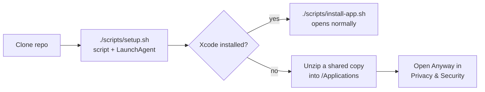

**Opening a shared zip the first time.** macOS says it can't verify the app is free of malware. On macOS 15 and later, right-click → Open no longer gets past this. Either:

1. Try to open the app once, then go to **System Settings → Privacy & Security**, click **Open Anyway** and enter the Mac's password. This is needed only once.
2. Or remove the quarantine flag in Terminal: `xattr -dr com.apple.quarantine "/Applications/Brew Updates.app"`

**Sharing without the warning** would need a paid Apple Developer Program membership, a Developer ID Application certificate, hardened runtime turned on (`ENABLE_HARDENED_RUNTIME` is `NO` in `app/project.yml` and must be tested with brew, launchctl and the askpass helper), and notarizing the zip with `xcrun notarytool submit` and `xcrun stapler staple`. None of that is set up yet.

## Troubleshooting

| Symptom | Check |
| --- | --- |
| Scheduled run didn't happen | `launchctl list com.user.brew-update`, then `tail ~/.brew_logs/launchagent_error.log` |
| Exit code 5 | Another run (scheduled, app or terminal) is in progress. A stale lock clears itself |
| Network errors (exit 2) | `ping -c 3 github.com`. Raise `BREW_UPDATE_MAX_RETRIES` / `BREW_UPDATE_TIMEOUT` |
| Disk space (exit 3) | `df -h $(brew --prefix)`, `brew cleanup --prune=all` |
| Scan skipped | `grype version`. Install with `brew install --cask grype` |
| Grype's first scan is slow | It's downloading its vulnerability DB. Later scans use the cached copy |
| No notifications | System Settings → Notifications → terminal-notifier / Script Editor; Focus mode; `ENABLE_NOTIFICATIONS` |
| Script and `~/bin` copy differ | Run `./scripts/setup.sh` |

For anything else, run `--dry-run --verbose` and read the run's `.log` and `.doctor.log`.

## Known constraints

- **macOS first.** Homebrew also runs on Linux, but the LaunchAgent, notifications, casks and the app are macOS-only, and a cross-platform app isn't planned. The script on its own is meant to run on Linux too (rename it without `.command` and schedule it with cron), but that path is untested.
- **Bash 3.2.** The LaunchAgent runs `/bin/bash`, so the script avoids associative arrays and `mapfile`.
- **Self-updating casks are skipped.** `auto_updates` casks aren't upgraded or counted as outdated. The app shows the app's own version for them instead.
- **Scans are snapshots.** The app hides findings for formulae that are no longer installed. Scan Now results aren't added to the trend chart.
- **No bottle provenance check.** `brew verify <formula>` can check a bottle's build attestation, but it downloads the bottle and needs the GitHub CLI signed in, so runs don't call it. Use it by hand when you want to check a specific formula.
- **Personal signing.** The app is signed with an Apple Development certificate (or ad hoc), not notarized, so a shared copy needs a one-time Gatekeeper override. See [Sharing with others](#sharing-with-others).

## Roadmap

Shipped work is listed in [docs/CHANGELOG.md](docs/CHANGELOG.md). Open ideas are tracked in [docs/IMPROVEMENTS.md](docs/IMPROVEMENTS.md). Python/uv updates are deliberately out of scope here and belong in a separate script.

---

_Maintained by John Xanthopoulos · [MIT License](LICENSE)_
