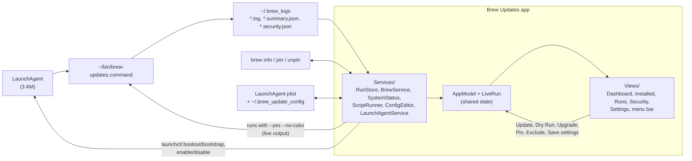

# Brew Updates App — Xcode & SwiftUI Guide

A working guide to the SwiftUI app in `app/`: how to open and run it in Xcode, when to use
Xcode versus the terminal, and the SwiftUI concepts the code uses, each pointing at the file
where it appears.

## Contents

- [How the pieces fit](#how-the-pieces-fit)
- [First-time setup](#first-time-setup)
- [Working in Xcode](#working-in-xcode)
- [When to use Xcode vs. the terminal](#when-to-use-xcode-vs-the-terminal)
- [SwiftUI concepts used in this app](#swiftui-concepts-used-in-this-app)
- [Trying the actions safely](#trying-the-actions-safely)
- [Things to try](#things-to-try)
- [Troubleshooting](#troubleshooting)

## How the pieces fit



The app never upgrades anything itself: **Update All**, **Dry Run** and **Upgrade** all run the
same deployed script the LaunchAgent uses, so every run gets the same backup, logs, summary
and run lock. The only direct changes are `brew pin`/`unpin`, the settings in
`~/.brew_update_config` (exclusions and the Settings window), and the LaunchAgent's schedule.

| Folder | What lives there | Has UI code? |
|--------|------------------|--------------|
| `BrewUpdates/Models/` | Plain data types and parsers (run summary, logs, schedule, grype report) | No |
| `BrewUpdates/Services/` | Talking to the system: files, `brew`, `launchctl` | No |
| `BrewUpdates/AppModel.swift` | The single shared state object the screens read, and the actions (run, stop, pin, exclude) | No (but drives the UI) |
| `BrewUpdates/LiveRun.swift` | Output and state of a run started from the app | No |
| `BrewUpdates/Views/` | SwiftUI screens and small components | Yes |
| `BrewUpdatesTests/` | Unit tests for Models and Services | No |
| `project.yml` | XcodeGen definition the Xcode project is generated from | — |

Keeping parsing and file access out of the views is deliberate: that code is testable without
launching the app, and the views stay focused on layout.

## First-time setup

```bash
brew install xcodegen swiftlint     # once
cd app
xcodegen generate                   # creates BrewUpdates.xcodeproj (not committed to git)
open BrewUpdates.xcodeproj
```

Re-run `xcodegen generate` whenever files are **added, removed or renamed**, or after
`project.yml` changes. Xcode notices the regenerated project and reloads it.

> **Don't change build settings in Xcode's project editor.** The next `xcodegen generate`
> overwrites them. Make setting changes in `project.yml` instead.

## Working in Xcode

### The window at a glance

- **Navigator** (left, ⌘0): the file tree. ⌘1 shows files; ⌘⇧O opens any file by name.
- **Editor** (centre): code. Option-click any symbol for its documentation.
- **Canvas** (right of editor, ⌥⌘↩): live SwiftUI previews.
- **Debug area** (bottom, ⌘⇧Y): console output from `print()` and runtime warnings.
- **Toolbar**: the scheme (`BrewUpdates`) and destination (`My Mac`) next to the ▶ button.

### Everyday shortcuts

| Action | Shortcut | Notes |
|--------|----------|-------|
| Build | ⌘B | Compile only; errors show inline and in the Issue navigator (⌘5) |
| Run | ⌘R | Builds, then launches the app. A mug icon appears in the menu bar |
| Stop | ⌘. | Quits the running app |
| Test | ⌘U | Runs `BrewUpdatesTests`; results in the Test navigator (⌘6) |
| Clean build folder | ⌘⇧K | Use when the build acts strangely |
| Show/refresh preview | ⌥⌘↩ / ⌥⌘P | Preview the open SwiftUI file |
| Open quickly | ⌘⇧O | Jump to any file or type |

### Previews

Every screen file ends with a `#Preview { ... }` block. Open, say,
`Views/DashboardView.swift` and press ⌥⌘↩: the canvas renders the view, and edits to the
layout update it within a second or two. Previews here use a real `AppModel()`, so they show
your actual runs and packages. If a preview stops updating, press ⌥⌘P.

### Debugging

- Click a line number to set a **breakpoint** (blue arrow). Run with ⌘R; when execution
  stops there, hover over variables or type `po someVariable` in the console.
- `print("…")` output appears in the debug area.
- Purple runtime warnings (for example "Publishing changes from background threads") point
  at concurrency mistakes. Treat them as bugs.

## When to use Xcode vs. the terminal

| Task | Where | Why |
|------|-------|-----|
| Writing and changing code | Either (Claude edits files from the terminal) | Files are plain Swift; Xcode picks up changes on disk |
| Adding/removing files | Terminal: `xcodegen generate` | The project file is generated |
| Checking it compiles, running tests | Terminal: `xcodebuild … test` (what Claude runs) or ⌘U | Same result |
| **Seeing the app run** | **Xcode: ⌘R** | Launches it with the debugger attached |
| **Tweaking layout and visuals** | **Xcode: previews** | Instant visual feedback |
| Stepping through a bug | Xcode: breakpoints | The debugger is in Xcode |
| Build settings, signing | `project.yml`, then regenerate | Xcode edits would be overwritten |
| Committing | Terminal | Pre-commit hooks (SwiftLint, ShellCheck, gitleaks…) run on `git commit` |

**In practice:** Claude makes changes and verifies them from the terminal. You switch to
Xcode to press ⌘R and look, or to use previews when you want to adjust how something looks.

Terminal equivalents (useful for scripts):

```bash
cd app
xcodebuild -project BrewUpdates.xcodeproj -scheme BrewUpdates -destination 'platform=macOS,arch=arm64' build
xcodebuild -project BrewUpdates.xcodeproj -scheme BrewUpdates -destination 'platform=macOS,arch=arm64' test
swiftlint lint --strict
```

## SwiftUI concepts used in this app

Read these roughly in order; each builds on the previous one.

### 1. Views are values that describe the UI

A view is a `struct` conforming to `View` with a `body` describing what to show. SwiftUI calls
`body` again whenever the data it depends on changes. You never update the screen by hand.

```swift
struct StatusBadge: View {          // Views/Components.swift
    let status: RunStatus
    var body: some View {
        Label(status.title, systemImage: status.systemImage)
            .foregroundStyle(status.color)
    }
}
```

`some View` means "some specific view type the compiler works out". You don't have to spell
out the nested type.

### 2. Modifiers wrap views, and order matters

`.padding()`, `.background(...)` and `.font(...)` each return a *new* view wrapping the old one.
`.padding().background(.red)` colours the padded area; `.background(.red).padding()` colours
only the content and pads outside it. See `Card` in `Views/Components.swift`.

### 3. Layout containers

`VStack`/`HStack` stack views vertically or horizontally, `Spacer()` pushes them apart, `Grid`
aligns rows and columns (the System card in `DashboardView`), and `LazyVGrid` flows cards into
as many columns as fit (the dashboard cards).

### 4. `@State`: data a view owns

`@State` stores values that belong to one view and survive re-renders, such as the search text
and filter in `InstalledView`. Changing one re-renders the view. Mark them `private`.

### 5. Bindings (`$`): letting a control edit state

`TextField("…", text: $searchText)` passes a **binding**, a two-way connection, so the text
field can both read and write `searchText`. The `$` prefix makes a binding from a `@State`
property. Custom bindings with `Binding(get:set:)` appear in `LogView` (level toggles) and
`SecurityView` (severity toggles).

### 6. `@Observable` models shared through the environment

`AppModel` is an `@Observable` class holding the app-wide data. It's created once in
`BrewUpdatesApp` with `@State` and injected with `.environment(model)`. Any view reads it with:

```swift
@Environment(AppModel.self) private var model
```

SwiftUI records which properties each view's `body` actually reads and re-renders only those
views when they change. To make a binding into the model (as `ContentView` does for the
sidebar selection), wrap it with `@Bindable var model = model`.

### 7. Derived data as computed properties

Instead of storing filtered lists, views compute them, for example `rows` in `InstalledView`
and `outdatedPackages` in `AppModel`. Computed values can't go stale because they're
recalculated from the source data on every render.

### 8. Lists, tables and identity

`List`, `ForEach` and `Table` need to tell rows apart, so the models conform to `Identifiable`
(an `id` property). `Run.id` is the run timestamp; `InstalledPackage.id` is `formula:name`.
Stable IDs let SwiftUI animate and keep selection correctly. `Table` with `sortOrder:` gives
clickable, sortable column headers (`InstalledView`, `SecurityView`).

### 9. Async work: `async`/`await` and `.task`

Loading data (reading files, running `brew`) is `async` so the UI never freezes.
`.task { await model.start() }` starts work when a view appears and cancels it when the view
disappears. `.task(id: selectedRunID)` reruns whenever the id changes (`SecurityView`).
`async let` in `AppModel.refresh()` runs several loads at the same time.

### 10. `@MainActor` and `Sendable`

UI state must only change on the main thread. `@MainActor` on `AppModel` makes the compiler
enforce that. Background work happens in `Services/` (plain structs marked `Sendable`, safe to
pass between threads) and hands results back to the model. Swift 6 checks this at compile
time, so data races show up as build errors instead of random crashes.

### 11. `@ViewBuilder` and generic containers

`@ViewBuilder` lets a function or property return different views from an `if`/`switch`
(`ContentView.detail(for:)`). `Card<Content: View>` takes a `@ViewBuilder` closure so it can
wrap any content, just like `VStack { … }`.

### 12. Navigation and scenes

- `NavigationSplitView` gives the sidebar-plus-detail layout (`ContentView`).
- `HSplitView` is the resizable list and detail split in `RunsView`.
- `.inspector` is the collapsible details panel on the right of `InstalledView`.
- An `App` is made of **scenes**: here a `Window` and a `MenuBarExtra`
  (`BrewUpdatesApp.swift`). Both share one `AppModel`, so the menu bar and window always agree.

### 13. Streaming results with `AsyncStream` and `for await`

A run produces output for minutes, so `ScriptRunner.launch` can't just return a value at the
end. Instead it returns an `AsyncStream<ScriptEvent>`: a sequence whose elements arrive over
time. `AsyncStream.makeStream` gives a stream plus a *continuation*; the background reader
calls `continuation.yield(.output(lines))` for each batch of lines it reads and `finish()`
at the end. Lines are sent in batches, not one by one, because brew can print faster than
the screen redraws. Updating the UI per line triggers Xcode's "onChange … tried to update
multiple times per frame" warning. On the other
side, `AppModel.start(_:)` loops with:

```swift
for await event in launched.events {   // suspends until the next line arrives
    switch event { ... }
}
```

The loop doesn't block the UI: while it waits, the main thread keeps drawing.

### 14. A second `@Observable` object for fast-changing data

`LiveRun` gets a new line many times a second. If those lines lived on `AppModel`, every view
that reads anything from the model could re-render. A separate `LiveRun` object means only
the views that read `run.lines` (the live output list) update per line.

### 15. Confirmation dialogs and alerts driven by state

Views don't "show" a dialog imperatively. `AppModel.pendingAction` holds the action waiting
for confirmation, and `ContentView` attaches:

```swift
.confirmationDialog(title, isPresented: …, presenting: model.pendingAction) { action in
    Button(action.title) { model.start(action) }
    Button("Cancel", role: .cancel) {}
}
```

Setting `pendingAction` from anywhere (the toolbar, the dashboard, the menu bar, the
Installed right-click menu) shows the same dialog. `.alert(…, presenting: model.actionError)`
works the same way for errors.

### 16. Multiple selection and context menus

`Table(rows, selection: $selection)` allows several selected rows when `selection` is a
`Set<ID>` instead of an optional single ID (`InstalledView`). `.contextMenu(forSelectionType:)`
builds the right-click menu from the rows it applies to. `PackageActions` is one view used in
both the context menu (where each `Button` becomes a menu item) and the inspector (where they
are regular buttons). SwiftUI adapts the same controls to where they're placed.

### 17. Scrolling to the newest line

`ScrollViewReader` gives a `proxy` that can scroll to any row by its `id`. `LiveRunView` calls
`proxy.scrollTo(last.id, anchor: .bottom)` in `.onChange(of: run.lines.count)`, so the list
follows the output unless **Follow output** is off. `Text(run.startedAt, style: .timer)` is a
label that counts up by itself, with no timer code needed.

### 18. Reaching AppKit when SwiftUI has no API

SwiftUI has no hook for "the user chose Quit". `@NSApplicationDelegateAdaptor` in
`BrewUpdatesApp.swift` plugs in a classic AppKit `AppDelegate`, whose
`applicationShouldTerminate` asks before quitting during a run and returns `.terminateLater`
until the script has stopped. The delegate owns `AppModel`, so the scenes and the quit
handling share one instance.

### 19. The Settings scene and tabs

`Settings { SettingsView() }` in `BrewUpdatesApp.swift` is a scene like `Window`, but macOS
adds **Settings…** (⌘,) to the app menu for it. Inside, `TabView` with `Tab("Schedule",
systemImage: …)` gives the icon tabs at the top, as in System Settings. Anywhere else,
`@Environment(\.openSettings)` gives an action that opens the window (the menu bar's
**Settings…** item and the dashboard's **Edit schedule…** link).

### 20. Draft and original: editing with Save and Revert

Each settings tab keeps two copies in `@State`: `original` (what's on disk) and `draft` (what
the controls edit). Because the draft types (`ScheduleDraft`, `ConfigDraft`) are `Equatable`
structs, "unsaved changes" is simply `draft != original`, Revert is `draft = original`, and
Save writes the draft and reloads both. Value types make this easy: assigning a struct
copies it, so editing the draft can never change the original by accident.

`ConfigDraft.changes(from:)` compares the two and writes only the keys that changed, so lines
you edited by hand in the config file are left alone.

### 21. `@Binding`: editing a parent's state from a child view

`ExclusionListEditor` (in `UpdateSettingsView.swift`) declares `@Binding var names`. The
parent passes `$draft.excludedFormulae`, and the child adds and removes names directly in
the parent's draft. `@State` *owns* data; `@Binding` *borrows* it.

Custom bindings appear again here: the time `DatePicker` edits a `Date`, but the draft stores
an hour and a minute, so `timeBinding` converts both ways. "Include casks" is a binding that
inverts `skipCasksByDefault`.

## Trying the actions safely

- **Dry Run** (toolbar Update menu ▾, or the menu bar) changes nothing and shows the live output.
  Try **Stop** partway through. The run appears in the list as *Cancelled*.
- **Exclude from Updates** edits `~/.brew_update_config`; **Include** puts it back. Open the
  file to watch the `EXCLUDED_FORMULAE=` line change while your comments stay.
- **Pin**/**Unpin** run `brew pin`/`brew unpin`; check with `brew list --pinned`.
- **Update All…** and **Upgrade…** always ask first, and run exactly what the 3 AM job runs.
- **Settings → Schedule**: change the time and press **Save**, then check with
  `launchctl print gui/$(id -u)/com.user.brew-update | grep -A4 "event triggers"` or the
  dashboard's Schedule card. The previous plist is kept as
  `~/Library/LaunchAgents/com.user.brew-update.plist.app-backup`. Comments in the plist are
  not preserved when the app rewrites it.
- **Settings → Updates** edits `~/.brew_update_config`; only the settings you change are
  rewritten.

## Things to try

Small, safe changes for practice. Use previews (⌥⌘↩) to see the result immediately.

1. **Change the card layout.** In `DashboardView`, change `GridItem(.adaptive(minimum: 260))`
   to `200` or `400` and watch the columns reflow.
2. **Add a row to the System card.** Add another `GridRow` showing `model.runs.count` as
   "Runs on disk".
3. **Add a filter.** Add `case pinned = "Pinned"` to `InstalledView.Filter` and handle it in
   `matchesFilter` (`package.isPinned`). The segmented control picks it up automatically.
4. **Change colours.** Edit `RunStatus.color` in `Components.swift`, for example make
   `.partial` yellow.
5. **Write a test.** Add a case to `ScheduleTests` for a monthly schedule
   (`<key>Day</key><integer>1</integer>`) and run ⌘U.
6. **Add a run option.** Add `case updateFormulaeOnly` to `ScriptAction` that passes
   `--skip-casks`, fill in the `switch` statements the compiler flags, and add it to the
   toolbar menu in `ContentView.RunControl`.
7. **Colour the live output.** In `LogLineRow` (`LogView.swift`), give `.output` lines that
   start with `==>` (brew's headings) a bold font.

## Troubleshooting

| Symptom | Fix |
|---------|-----|
| New file doesn't appear in Xcode / "cannot find X in scope" | `cd app && xcodegen generate` |
| macOS asks whether `xctest` or Xcode may access Documents | The repo is in `~/Documents`. Allow it for Xcode. Command-line builds use the default DerivedData in `~/Library` to avoid this |
| Orange banner "Deployed script is v…" | Run `./scripts/setup.sh` from the repo root to deploy the current script |
| Issue navigator shows "Update to recommended settings" | Usually after an Xcode upgrade. **Don't click Perform Changes** (the next `xcodegen generate` undoes it). Note the pre-checked settings, add them to `settings.base` in `project.yml`, set `options.xcodeVersion` to the new Xcode version, and regenerate |
| Schedule Save says an update is running | Reloading the LaunchAgent would stop a scheduled run in progress. Wait for it to finish (Runs shows it as Running) |
| Schedule toggle won't turn on | Check `launchctl print gui/$(id -u)/com.user.brew-update`. If the plist is missing, run `scripts/setup.sh` |
| Update / Dry Run greyed out | A run is already in progress (scheduled or from Terminal), or the deployed script is older than the app needs (see the orange banner) |
| Run ends at once with "Another update is already running" | Exit code 5: another run holds `~/.brew_logs/.brew-updates.lock`. Wait for it, or check the Runs list |
| Preview shows an error or stops updating | ⌥⌘P to refresh; ⌘⇧K then ⌘B if it persists |
| Build fails after pulling changes | `xcodegen generate`, then ⌘⇧K and build again |
| "Untrusted developer" / signing prompts | The app is ad-hoc signed for local use (`CODE_SIGN_IDENTITY: "-"` in `project.yml`); building it yourself avoids Gatekeeper prompts |
